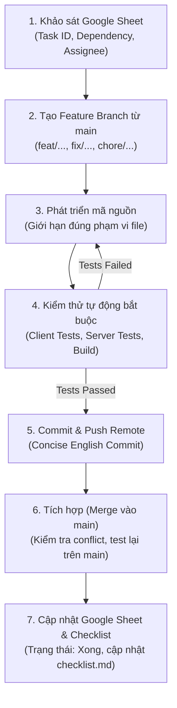

# QUY TRÌNH PHÁT TRIỂN & TIÊU CHUẨN LÀM VIỆC DỰ ÁN CINEHUB (WORKFLOW.MD)
> **Dự án:** Hệ thống đặt vé xem phim trực tuyến CineHub (Nhóm 115 - LTW Cuối Kỳ)  
> **Áp dụng cho:** Tất cả thành viên nhóm (Kỳ, Tuấn Anh, Phúc, Tú) và tất cả các hệ thống AI Agent (Single Agent, `/teamwork`, `/swarm`).  
> **Hiệu lực:** Quy chuẩn tối cao (Single Source of Truth - SSOT). Mọi hoạt động lập trình, review, merge và quản lý tiến độ đều bắt buộc phải tuân theo tài liệu này.

---

## 1. NGUYÊN TẮC CỐT LÕI (CORE TENETS)

1. **Bằng chứng trước khẳng định (Evidence Before Assertion):**
   - Tuyệt đối không bao giờ tuyên bố một task "hoàn thành" hay một bug "đã sửa" nếu chưa trực tiếp chạy lệnh test thực tế và có output log thành công (`pass`, `exit code 0`).
2. **Kỷ luật Git & Phân nhánh độc lập (Branch Isolation):**
   - Tuyệt đối không commit trực tiếp vào `main`. Mỗi task phải được thực hiện trên đúng nhánh được chỉ định.
   - Commit message bắt buộc viết bằng **tiếng Anh ngắn gọn, rõ nghĩa** (Concise English), mô tả đúng bản chất thay đổi (ví dụ: `Implement booking API endpoint with authoritative pricing and collision handling`), không chèn tiền tố thừa như `[AI]`, `AI-generated:`.
3. **Giới hạn phạm vi nghiêm ngặt (Strict Scope Confinement):**
   - Chỉ chỉnh sửa các file thuộc phạm vi được giao trong cột *"File/thư mục được sửa (chỉ mình bạn)"* trên Google Sheet. Tránh sửa lan man sang file người khác để triệt tiêu merge conflict.
4. **Không cài thư viện tùy tiện:**
   - Không tự ý thêm package vào `client/package.json` hoặc `server/package.json` mà chưa qua kiểm tra tương thích và trao đổi nội bộ (tránh lỗi crash ứng dụng do thiếu phụ thuộc như case `react-toastify`).
5. **Chuẩn mực & Giữ gìn hình ảnh trên Google Sheet (Sheet Public Hygiene):**
   - Google Sheet dự án là tài liệu công khai (giảng viên chấm điểm, hội đồng nghiệm thu và người ngoài có thể xem trực tiếp).
   - Tuyệt đối **KHÔNG ghi các thông tin thừa thãi, nhạy cảm hoặc không phục vụ quản lý dự án**:
     - **CẤM ghi các từ khóa AI:** Tuyệt đối không nhắc đến `AI`, `Agent`, `Prompt`, `Bot`, `Teamwork`, `Swarm`, `Auto-generated`, v.v. trên bất kỳ ô nào của Sheet.
     - **CẤM ghi lý do cá nhân / mâu thuẫn nội bộ:** Không ghi các giải thích như *"làm hộ"*, *"bận thi"*, *"không làm được"*, v.v. Khi phân công lại công việc giữa các thành viên, chỉ đơn thuần cập nhật tên người phụ trách một cách tự nhiên và chuyên nghiệp.
     - **Cột "Ghi chú" (Notes):** Giữ sạch sẽ, chỉ ghi thông tin chuyên môn cần thiết (ví dụ mã PR ngắn gọn) hoặc để trống. Không biến cột ghi chú thành nhật ký debug hay thảo luận.

---

## 2. QUY TRÌNH 7 BƯỚC TIÊU CHUẨN (THE 7-STEP DEVELOPMENT LIFECYCLE)



### Bước 1: Khảo sát & Nhận Task từ Google Sheet
- Mở và tra cứu dữ liệu từ Google Sheet quản lý dự án (tab `Task management`).
- Xác định:
  - **Mã Task (ID):** K01-K14 (Kỳ), A01-A15 (Tuấn Anh), P01-P15 (Phúc), T01-T13 (Tú).
  - **Phụ thuộc (Dependencies):** Không bắt đầu làm task nếu các task phụ thuộc chưa ở trạng thái "Xong" hoặc chưa được mở khóa.
  - **Tiếp quản task:** Nếu tiếp quản nhiệm vụ để mở khóa luồng chính, phải cập nhật cột `Người phụ trách` (Col C) thành người thực hiện mới và chuyển `Trạng thái` (Col E) sang **"Đang làm"**.

### Bước 2: Tạo Feature Branch từ `main` mới nhất
- Luôn đồng bộ `main` trước khi rẽ nhánh:
  ```powershell
  git checkout main
  git pull origin main
  git checkout -b <tên-nhánh-chuẩn>
  ```
- **Quy tắc đặt tên nhánh:**
  - `feat/<tên-tính-năng>`: Cho tính năng mới (`feat/redux-booking`, `feat/seat-map`, `feat/booking-history`).
  - `fix/<tên-lỗi>`: Cho sửa lỗi (`fix/movie-validator`, `fix/security`).
  - `chore/<tên-nhiệm-vụ>`: Cho cấu hình, build, deploy (`chore/deploy`).
  - `docs/<tên-tài-liệu>`: Cho tài liệu và báo cáo (`docs/report-ky`).

### Bước 3: Phát triển mã nguồn theo Quy chuẩn Thiết kế & Kỹ thuật
- **Frontend (Client):**
  - Tuân thủ thiết kế Cinema Dark Mode tại [AWESOME_DESIGN_SKILLS.md](file:///c:/Users/Admin/OneDrive/Documents/GitHub/LTW%20CUOI%20KY/115_LTW_CuoiKy/AWESOME_DESIGN_SKILLS.md):
    - Màu chính CTA: Rose 600 (`#e11d48`).
    - Màu ghế/vé VIP: Amber 500 (`#f59e0b`).
    - Màu thành công: Emerald 500 (`#10b981`).
    - Nền: Cinema Dark (`#020617`, `#0f172a`).
  - Responsive: Bản đồ ghế, bảng biểu phải hỗ trợ cuộn ngang (`overflow-x-auto min-w-fit`) trên mobile.
  - Redux Toolkit: Quản lý tối đa 8 ghế, chặn chọn ghế thứ 9, xử lý `clearSeats`, selectors chuẩn hóa.
- **Backend (Server):**
  - Express 5 + Mongoose 9.
  - Luôn tính tiền vé độc lập từ Database (Authoritative DB pricing), bỏ qua giá client gửi lên.
  - Kiểm tra suất chiếu trong quá khứ $\rightarrow$ trả về HTTP 400.
  - Bắt lỗi trùng vé (MongoDB Unique Index E11000) $\rightarrow$ trả về HTTP 409 với `conflictingSeats`.
  - Atomic Rollback: Khi xảy ra lỗi giữa chừng trong việc lưu nhiều vé, phải dọn dẹp các ticket đã insert để không để lại dữ liệu mồ côi.

### Bước 4: Kiểm thử tự động bắt buộc (Verification Gate - Zero Tolerance)
Mọi thay đổi code trước khi merge **bắt buộc** phải vượt qua 3 cổng kiểm tra sau:
1. **Client Unit & Integration Tests:**
   ```powershell
   npm --prefix client test -- --watchAll=false
   ```
   *Yêu cầu:* 100% test suites passed (Hiện tại có 5 suites, 48 tests).
2. **Client Production Build:**
   ```powershell
   npm --prefix client run build
   ```
   *Yêu cầu:* Exit code 0, không có runtime/build error.
3. **Server Integration Tests:**
   ```powershell
   npm --prefix server test
   ```
   *Yêu cầu:* 100% tests passed (Hiện tại có 6 integration tests kiểm tra booking API, authentication, collision handling, rollback).

### Bước 5: Commit và Push lên GitHub
- Kiểm tra diff bằng `git diff` và staged changes bằng `git status`.
- Commit bằng thông điệp tiếng Anh ngắn gọn:
  ```powershell
  git add <các-file-thay-đổi>
  git commit -m "Concise English description of changes"
  git push origin <tên-nhánh>
  ```

### Bước 6: Tích hợp vào `main` & Xử lý xung đột (Merge & Conflict Resolution)
- Chuyển về `main` và kéo code mới nhất:
  ```powershell
  git checkout main
  git pull origin main
  ```
- Merge nhánh tính năng vào `main`:
  ```powershell
  git merge <tên-nhánh>
  ```
- **Nếu xảy ra conflict:**
  - Mở từng file conflict, rà soát cẩn thận, không được xóa code đã merge trước đó của đồng đội.
  - Chạy lại toàn bộ test suite (Bước 4) ngay trên trạng thái conflict-resolved.
  - Hoàn tất merge và đẩy lên remote:
  ```powershell
  git push origin main
  ```

### Bước 7: Cập nhật Google Sheet và Checklist kiểm thử
- Sử dụng công cụ tích hợp Google Sheets CLI để cập nhật dữ liệu trên Sheet theo đúng chuẩn mực:
  - Chỉ cập nhật các giá trị chuẩn: `Trạng thái` thành **"Xong"** (Col E), và `Người` thành tên thành viên chính thức (Col C).
  - Không ghi bất kỳ nội dung nào làm lộ dấu vết công cụ hay giải thích vụn vặt vào cột `Ghi chú`.
- Cập nhật tài liệu kiểm thử kỹ thuật nội bộ tại file [checklist_kiem_tra_web.md](file:///C:/Users/Admin/.gemini/antigravity/brain/80c83b3a-dd67-459d-90c6-147a1c5f4ad3/checklist_kiem_tra_web.md) để đội ngũ nắm rõ trạng thái thực tế.

---

## 3. QUY ĐỊNH ĐẶC THÙ CHO HỆ THỐNG ĐA AGENT (/TEAMWORK & /SWARM)

Khi người dùng kích hoạt các chế độ làm việc đa tác nhân (Multi-Agent), các agent tham gia phải tuân thủ nghiêm ngặt các quy tắc sau:

### 3.1. Đối với chế độ Teamwork (`/teamwork`)
- **Coordinator:**
  - Nhận task từ người dùng và đối chiếu trực tiếp với `WORKFLOW.md` và Google Sheet.
  - Thiết lập tiêu chí hoàn thành (Acceptance Criteria) dựa trên Definition of Done (DoD) của từng task.
  - Điều phối các Worker chạy trên các feature branch tách biệt.
- **Workers:**
  - Mỗi Worker chịu trách nhiệm duy nhất 1 task hoặc 1 nhóm file độc lập.
  - Bắt buộc viết test hoặc script xác thực cho phần việc của mình.
- **Auditor / Reviewer (Victory Auditor):**
  - Tiến hành review độc lập: chạy lại toàn bộ test suites (`npm test` ở cả client và server), kiểm tra build.
  - Chỉ khi có `VICTORY CONFIRMED` và đầy đủ bằng chứng pass mới cho phép Coordinator đóng việc và cập nhật Google Sheet.

### 3.2. Đối với chế độ Swarm (`/swarm`)
- **Phân tách bài toán (Lean Swarm Partitioning):**
  - Chia nhỏ công việc sao cho mỗi Worker làm việc trên một file/module riêng biệt.
  - Cấm tình trạng 2 Workers cùng sửa chung một file cùng một lúc (nguyên nhân gây race condition và conflict).
- **Worker chuyên trách kiểm định (Verifier Worker):**
  - Trong mỗi Swarm có từ 2-4 Workers, bắt buộc phải có 1 Verifier Worker.
  - Verifier chịu trách nhiệm kiểm tra code do các worker khác post lên board, chạy test tự động và báo cáo kết quả.
- **Dọn dẹp và Land Code (Clean Landing):**
  - Trước khi Coordinator thực hiện lệnh `kill` để đóng một Worker, toàn bộ code của worker đó phải được merge sạch sẽ và test hoàn tất vào nhánh chính.

---

## 4. TÀI KHOẢN VÀ MÔI TRƯỜNG THỬ NGHIỆM CHUẨN

- **Backend Port:** `5000` (`http://localhost:5000`)
- **Frontend Port:** `3000` (`http://localhost:3000`)
- **Health Check Endpoint:** `GET http://localhost:5000/api/health`
- **Seed Dữ liệu mẫu:** `node server/src/seed/index.js`
- **Tài khoản kiểm thử mặc định:**
  - **Quản trị viên (Admin):** `admin@cinema.local` / `Admin@123`
  - **Thành viên (Member):** `member@cinema.local` / `Member@123`
