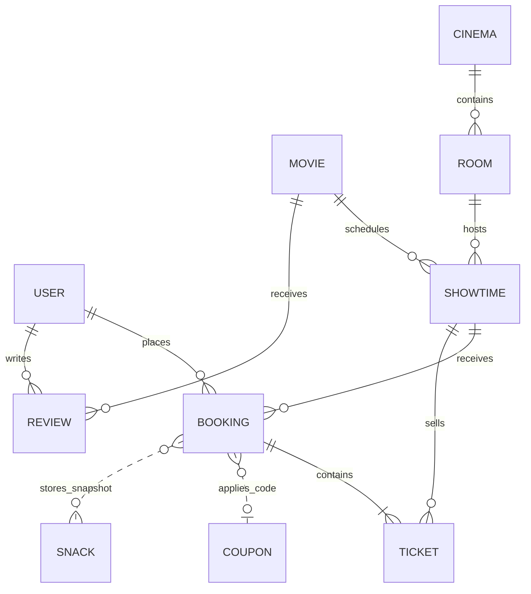

# Thiết kế cơ sở dữ liệu CineHub

## 1. Phạm vi

CineHub dùng MongoDB với Mongoose. Mỗi tài nguyên chính được lưu thành collection riêng; các quan hệ dài hạn dùng `ObjectId` tham chiếu. Cách này phù hợp với các thao tác tìm kiếm, cập nhật và thống kê theo phim, suất chiếu, phòng hoặc người dùng. Một vài dữ liệu tại thời điểm đặt vé được chụp lại trong booking để lịch sử không đổi khi tên hoặc giá combo được cập nhật.

## 2. Collection và trường chính

| Collection | Trường chính | Vai trò |
| --- | --- | --- |
| `users` | `fullName`, `email`, `passwordHash`, `role`, `phone` | Tài khoản khách hàng và quản trị viên. Email duy nhất; mật khẩu chỉ lưu dạng hash. |
| `movies` | `title`, `description`, `genres[]`, `duration`, `releaseDate`, `status`, `ageRating`, `posterUrl`, `trailerYoutubeId` | Thông tin phim, trạng thái phát hành và dữ liệu hiển thị. |
| `rooms` | `name`, `rows`, `seatsPerRow`, `vipRows[]` | Cấu hình phòng. Sơ đồ ghế được tạo từ số hàng, số ghế mỗi hàng và các hàng VIP. |
| `cinemas` | `name`, `address`, `hotline`, `rooms[]` | Cụm rạp và danh sách phòng thuộc rạp. |
| `showtimes` | `movieId`, `roomId`, `startTime`, `endTime`, `standardPrice`, `vipPrice` | Lịch chiếu gắn với một phim và một phòng. |
| `bookings` | `userId`, `showtimeId`, `totalPrice`, `originalPrice`, `discountAmount`, `couponCode`, `snacks[]`, `status` | Đơn đặt vé đã xác nhận hoặc đã hủy; lưu snapshot tên/giá combo. |
| `tickets` | `bookingId`, `showtimeId`, `row`, `number`, `seatType`, `price`, `status` | Một vé cho một ghế ở một suất chiếu. Vé active đại diện ghế đang được bán/giữ. |
| `reviews` | `movieId`, `userId`, `rating`, `comment` | Đánh giá phim; một người chỉ có một đánh giá cho mỗi phim. |
| `coupons` | `code`, `discountType`, `discountValue`, `maxDiscount`, `minOrderAmount`, `expiresAt`, `maxUses`, `usedCount`, `isActive` | Mã giảm giá và giới hạn sử dụng. |
| `snacks` | `name`, `description`, `price`, `imageUrl`, `category`, `isAvailable` | Combo, bắp và nước bán kèm vé. |

Các model bật `timestamps`; Mongoose tự ghi `createdAt` và `updatedAt`. Trường `passwordHash` được loại khỏi truy vấn mặc định và không trả về trong JSON.

## 3. Quan hệ dữ liệu

`Cinema.rooms` là mảng `ObjectId` tham chiếu `Room`; index sparse unique trên trường này ngăn cùng một phòng được gán vào nhiều cụm rạp. `Booking.couponCode` lưu mã tại thời điểm áp dụng; `Booking.snacks` lưu `snackId` cùng tên, giá và số lượng lúc mua để hóa đơn cũ không thay đổi theo danh mục hiện tại.

## 4. Lý do chọn tham chiếu và snapshot

- `Showtime` tham chiếu `Movie` và `Room`, vì phim/phòng có thể được quản lý độc lập và nhiều suất có thể dùng chung các tài nguyên đó.
- `Booking` tham chiếu `User` và `Showtime`; `Ticket` tách riêng để kiểm tra ghế, hủy vé và tạo unique index theo `{ showtimeId, row, number }` chỉ khi `status: active`. Nhờ vậy hai booking không thể bán cùng ghế.
- `Review` tham chiếu phim và người viết. Unique index `{ movieId, userId }` chặn đánh giá lần hai ngay ở CSDL.
- Thông tin combo trong booking được nhúng dưới dạng snapshot để giữ đúng giá trị lịch sử. Mã giảm giá dùng chuỗi `couponCode`, không tham chiếu cứng vì mã được dùng và xác nhận tại thời điểm tạo booking.
- Thông tin phim, phòng và người dùng không được nhân bản vào từng suất chiếu/booking, tránh cập nhật đồng bộ nhiều bản ghi.

## 5. Ràng buộc và chỉ mục quan trọng

- `users.email`, `rooms.name`, `cinemas.name`, `snacks.name` và `coupons.code` là duy nhất.
- `showtimes` có index theo `roomId`, `startTime`, `endTime`; controller kiểm tra giao khoảng thời gian khi tạo và sửa suất.
- `tickets` có unique partial index theo suất và ghế, chỉ áp dụng cho vé active. Vé đã hủy không khóa ghế.
- `reviews` có unique index theo phim/người dùng và index theo phim/ngày tạo để tải danh sách đánh giá.
- Room giới hạn 5–50 hàng và 5–50 ghế mỗi hàng; `vipRows` không trùng và phải nằm trong số hàng của phòng.

## 6. Truy vấn và thống kê

1. Doanh thu theo phim: lọc booking `confirmed` theo ngày tạo, nối suất chiếu và phim, nhóm theo phim, cộng `totalPrice` và đếm vé active từ collection `tickets`.
2. Doanh thu theo ngày: lọc booking đã xác nhận, nhóm ngày bằng `$dateToString` với múi giờ `Asia/Ho_Chi_Minh`, cộng doanh thu.
3. Thể loại phim: tách mảng `genres` bằng `$unwind`, nhóm và đếm phim cho bộ lọc thể loại.
4. Tỷ lệ lấp đầy: nối mỗi suất với phòng và vé active, tính `soldTickets / (rows * seatsPerRow) * 100`; khi tổng ghế không dương, tỷ lệ bằng 0.

Các endpoint danh sách phim, suất chiếu và booking có lọc/phân trang ở server. Bộ lọc ngày dùng cận `$gte` và `$lt` để bao trọn ngày theo múi giờ Việt Nam.

## 7. Quy trình đặt vé và nhất quán

Giá ghế lấy từ suất chiếu và loại ghế ở server, không tin giá gửi từ client. Khi tạo booking, server kiểm tra tối đa 8 ghế, suất chưa bắt đầu, quyền sở hữu và trạng thái ghế. Unique index là chốt cuối chống tranh chấp đồng thời; lỗi trùng trả 409 kèm ghế xung đột. Nếu insert nhiều vé bị lỗi giữa chừng, server xóa các vé đã ghi để tránh dữ liệu mồ côi.

## 8. Seed dữ liệu demo

Seed tạo user admin/member, phim, phòng, suất chiếu, coupon, snack và một booking mẫu có hai vé active cho suất sắp tới. Lần chạy lại tìm booking confirmed hiện có của tài khoản demo và suất đó để không nhân đôi; phần vé mẫu có rollback booking nếu ghi vé thất bại.
