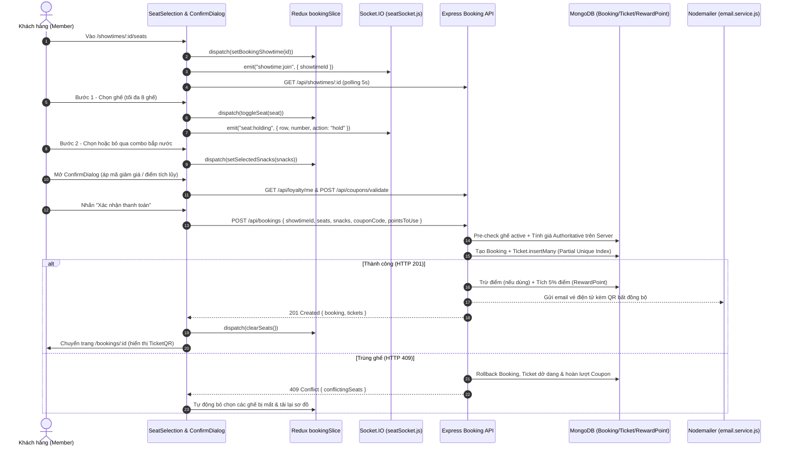
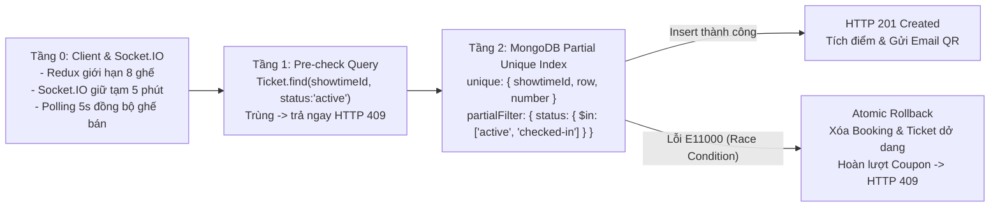

# Báo cáo Luồng đặt vé, Chống đặt trùng ghế, Custom Hooks và Phân công nhóm CineHub

> **Học phần:** Lập trình Web — Học viện Công nghệ Bưu chính Viễn thông (PTIT)  
> **Đề tài:** Hệ thống đặt vé xem phim trực tuyến CineHub (Nhóm 115)  
> **Phụ trách phần báo cáo:** Dương Tuấn Tú

---

## 1. Luồng đặt vé trực tuyến End-to-End

Nghiệp vụ đặt vé là luồng lõi quan trọng nhất của CineHub, kết nối chặt chẽ giữa trải nghiệm thời gian thực phía Client (React, Redux Toolkit, Socket.IO) và tính toàn vẹn giao dịch phía Server (Express, MongoDB, Nodemailer). Toàn bộ quy trình từ khi người dùng chọn suất chiếu đến khi nhận vé điện tử và soát vé tại quầy được thiết kế khép kín theo 6 giai đoạn liên tiếp.



*Hình 1: Biểu đồ tuần tự luồng đặt vé trực tuyến, xử lý xung đột ghế, tích điểm và gửi email xác nhận vé.*

### 1.1. Quy trình 2 bước trên giao diện (`SeatSelection.jsx` & `bookingSlice.js`)

Khi thành viên đã đăng nhập (`ProtectedRoute`) truy cập `/showtimes/:id/seats`, hệ thống khởi chạy song song 3 cơ chế đồng bộ: `useSeatPolling(id)` tải trạng thái sơ đồ ghế và danh sách ghế đã bán định kỳ 5 giây, `useSocketSeats(id)` kết nối WebSocket vào phòng suất chiếu để nhận ghế người khác đang giữ (`heldByOthers`), và `CountdownTimer` bắt đầu đếm ngược **5 phút (300 giây)**.

- **Bước 1 — Chọn ghế (`step === 'seats'`):** Sơ đồ phòng chiếu (`SeatMap.jsx`, `SeatRow.jsx`, `Seat.jsx`) hiển thị trực quan 4 trạng thái: ghế trống (Thường / VIP viền hổ phách `Amber 500`), ghế đang chọn (`Rose 600`), ghế người khác đang giữ tạm, và ghế đã bán (khóa chọn). Trên màn hình di động (`375px`), ma trận ghế hỗ trợ cuộn ngang (`overflow-x-auto touch-pan-x`) và giữ kích thước vùng chạm đạt chuẩn WCAG 2.2 AA. Mọi thao tác chọn/bỏ chọn đều đi qua `bookingSlice.js` với ràng buộc cứng **tối đa 8 ghế/đơn**; nếu người dùng chọn ghế thứ 9, reducer giữ nguyên 8 ghế và ghi nhận thông báo lỗi trong `state.error`.
- **Bước 2 — Chọn combo bắp nước (`step === 'snacks'`):** Sau khi chọn ít nhất 1 ghế và nhấn tiếp tục, giao diện chuyển mượt sang `SnackSelector.jsx` cùng thanh tiến trình 2 bước. Người dùng có thể tăng/giảm số lượng từng combo (0–20 phần); danh sách `selectedSnacks` được lưu trực tiếp trong Redux `bookingSlice` và cộng dồn tức thì vào `selectSnackTotal` và `totalAmount` trên bảng `BookingSummary.jsx`. Nếu không có nhu cầu, người dùng bấm **"Bỏ qua bắp nước"** (`clearSnacks()`) để mở thẳng hộp thoại xác nhận và đặt vé bình thường.
- **Tự động bảo vệ phiên giữ ghế:** Nếu hết 5 phút mà chưa hoàn tất thanh toán, `CountdownTimer` phát cảnh báo qua `useToast`, gọi `dispatch(clearSeats())` giải phóng toàn bộ ghế/combo đã chọn và tự động điều hướng về trang chi tiết phim.

### 1.2. Xác nhận thanh toán, Tính giá Authoritative và Hậu xử lý

Tại hộp thoại `ConfirmDialog.jsx`, khách hàng kiểm tra lại thông tin phim, phòng, suất chiếu, ghế, combo, có thể nhập mã giảm giá (`CouponInput.jsx`), tick chọn và nhập số điểm tích lũy muốn quy đổi (`GET /api/loyalty/me`, giới hạn không vượt quá số dư và tổng đơn), sau đó chọn thanh toán trực tiếp (`POST /api/bookings`) hoặc thanh toán VietQR (`POST /api/payments/create` giữ chỗ `pending` 10 phút).

Phía máy chủ (`server/src/controllers/booking.controller.js`) tuyệt đối **không tin tưởng giá tiền từ client gửi lên**:

| Thành phần tính toán | Nguồn dữ liệu tin cậy (Server) | Quy tắc nghiệp vụ áp dụng |
| :--- | :--- | :--- |
| Tiền vé từng ghế | `Showtime.standardPrice`, `Showtime.vipPrice`, `Room.vipRows` | Ghế thuộc hàng VIP áp dụng `vipPrice`, còn lại áp dụng `standardPrice`. |
| Tiền combo bắp nước | `Snack.find({ _id: { $in }, isAvailable: true })` | Từ chối combo ngừng bán (HTTP 400); số lượng mỗi món từ `1` đến `20`. |
| Giảm giá voucher | `evaluateCoupon(couponCode, originalPrice)` | Kiểm tra hạn dùng, trạng thái hoạt động, số lượt tối đa; tăng `usedCount` nguyên tử. |
| Giảm trừ điểm thưởng | `User.rewardPoints` | Chỉ chấp nhận số nguyên dương `<= rewardPoints`; trừ trực tiếp trên server và ghi log `RewardPoint` (`type: 'redeem'`). |
| Tích điểm tự động | `Math.floor(totalPrice * 0.05)` | Tự động cộng **5%** giá trị đơn vé sau giảm vào `User.rewardPoints` và ghi log `RewardPoint` (`type: 'earn'`). |
| Email vé điện tử & QR | `email.service.js` + `ticketEmail.html` | Gửi email bất đồng bộ kèm mã QR booking để không chặn luồng trả về HTTP `201`. |

*Bảng 1: Quy tắc tính giá Authoritative và hậu xử lý giao dịch đặt vé trên Server.*

Sau khi đặt vé thành công, trang `BookingDetail.jsx` và `MyBookings.jsx` hiển thị vé điện tử qua `TicketQR.jsx` (`qrcode.react`) cho phép tải ảnh PNG hoặc in vé (đã thoát HTML chống XSS). Tại rạp, nhân viên quản trị mở `/admin/scanner` (`TicketScanner.jsx`) gọi `POST /api/bookings/check-in` để chuyển trạng thái vé sang `checked-in`; vé quét lại lần 2 bị chặn `409 ALREADY_CHECKED_IN`, vé đã hủy (`cancelled`) hoặc sai suất chiếu (`WRONG_SHOWTIME`) báo lỗi đỏ rõ ràng.

---

## 2. Cơ chế chống đặt trùng ghế (Anti-Double-Booking)

Bài toán kinh điển trong hệ thống đặt vé trực tuyến là **Race Condition**: khi nhiều người dùng nhấn "Xác nhận thanh toán" cho cùng một ghế tại cùng một mili-giây. Nếu chỉ kiểm tra bằng một câu lệnh `find()` thông thường rồi mới `insert()`, hai request đồng thời có thể cùng thấy ghế trống và tạo ra hai vé hợp lệ cho cùng một chỗ ngồi. CineHub giải quyết triệt để vấn đề này bằng **kiến trúc phòng thủ 3 tầng (Multi-Tier Concurrency Control)**.



*Hình 2: Kiến trúc phòng thủ 3 tầng chống đặt trùng ghế và cơ chế Rollback khi xảy ra xung đột đồng thời.*

### 2.1. Chi tiết từng tầng bảo vệ

1. **Tầng 0 — Ngăn xung đột sớm theo thời gian thực (UX Layer):**
   - Ngay khi người dùng A bấm chọn ghế `A1`, `useSocketSeats` phát sự kiện `seat:holding` lên `server/src/socket/seatSocket.js`. Server lưu khóa tạm trong bộ nhớ RAM (`holdsByShowtime`, TTL 5 phút) và broadcast sự kiện `seat:holds` đến toàn bộ client trong cùng room `showtimeId`.
   - Người dùng B lập tức thấy ghế `A1` chuyển sang trạng thái đang có người giữ và không thể bấm chọn. Nếu người dùng A đóng tab hoặc mất mạng, sự kiện `disconnect` tự động giải phóng ghế ngay lập tức. Song song đó, `useSeatPolling` gọi lại API mỗi 5 giây như lớp dự phòng khi WebSocket gián đoạn.
2. **Tầng 1 — Kiểm tra nhanh trước khi ghi (Application Pre-check):**
   - Trong `createBooking` (`server/src/controllers/booking.controller.js`), server loại bỏ ghế trùng ngay trong mảng payload (HTTP `400`), sau đó thực hiện truy vấn `Ticket.find({ showtimeId, status: 'active', $or: seatConditions })`.
   - Nếu phát hiện ghế đã có vé `active`, server phản hồi ngay **HTTP 409 Conflict** kèm danh sách `conflictingSeats` mà chưa cần tạo document `Booking`.
3. **Tầng 2 — Ràng buộc duy nhất ở mức CSDL & Rollback nguyên tử (Database Atomic Guarantee):**
   - Trên schema `Ticket` (`server/src/models/Ticket.js`), hệ thống định nghĩa **Compound Partial Unique Index**:
     ```javascript
     ticketSchema.index(
       { showtimeId: 1, row: 1, number: 1 },
       { unique: true, partialFilterExpression: { status: { $in: ['active', 'checked-in'] } } }
     );
     ```
   - Việc dùng `partialFilterExpression: { status: { $in: ['active', 'checked-in'] } }` đạt đồng thời 2 mục tiêu: (a) Đảm bảo ở mức nhân CSDL không bao giờ tồn tại 2 vé `active` hoặc `checked-in` trùng `(showtimeId, row, number)` dù hàng chục request đến cùng lúc hay vé đã được soát tại rạp; (b) Khi khách hàng hủy vé hợp lệ (`PATCH /api/bookings/:id/cancel`), vé chuyển sang `status: 'cancelled'` nên tự động rời khỏi vùng khóa index, cho phép người khác đặt lại ghế đó ngay lập tức.
   - Khi `Ticket.insertMany(ticketDocs, { ordered: true })` vấp lỗi trùng khóa MongoDB `E11000` (trường hợp đặt nhiều ghế và ghế thứ 2 bị tranh chấp), khối `catch` lập tức thực hiện **Rollback**: xóa toàn bộ `Ticket` vừa chèn dở dang theo `bookingId`, xóa bản ghi `Booking` mồ côi, hoàn lại `usedCount` của `Coupon` (nếu có), truy vấn lại đúng danh sách ghế đang chiếm chỗ và trả về HTTP `409 Conflict` kèm `conflictingSeats`. Phía Client (`ConfirmDialog.jsx`) nhận mã `409` sẽ hiển thị cảnh báo rõ tên từng ghế đã mất, tự động `dispatch(toggleSeat)` bỏ chọn các ghế đó và gọi `onConflict()` làm mới sơ đồ.

### 2.2. Bằng chứng kiểm thử chịu tải đồng thời

Cơ chế trên được xác thực tự động qua bộ test `server/src/tests/booking.concurrency.test.js` và `server/src/tests/booking.test.js`:
- **Kịch bản 2 request song song (`Promise.all`) vào cùng 1 ghế:** Đúng **1 request thành công (`201`)** và **1 request bị từ chối (`409`)**.
- **Kịch bản 10 request song song (`Promise.all`) vào cùng 1 ghế:** Đúng **1 request thành công (`201`)** và **9 request bị từ chối (`409`)**, chỉ có đúng 1 document `Ticket` active tồn tại trong MongoDB.
- **Kịch bản đặt nhiều ghế bị trùng ở ghế thứ 2:** Rollback dọn sạch 100% ticket chèn dở dang, không để lại dữ liệu rác trong CSDL.

---

## 3. Hệ thống Custom Hooks đã xây dựng phía Client

Để tái sử dụng logic bất đồng bộ, tách biệt nghiệp vụ khỏi tầng giao diện và phòng chống triệt để rò rỉ bộ nhớ (memory leak), nhóm xây dựng 6 custom hooks tập trung tại `client/src/hooks/`:

| Custom Hook | Tham số đầu vào | Giá trị trả về | Cơ chế an toàn & Cleanup | Phạm vi sử dụng |
| :--- | :--- | :--- | :--- | :--- |
| **`useCountdown`** (`useCountdown.js`) | `(totalSeconds, onExpire)` | `secondsLeft` | Tính theo mốc `endAt = Date.now() + totalSeconds * 1000` chống trôi thời gian; lưu `onExpireRef` tránh reset interval; `clearInterval` khi unmount. | `CountdownTimer.jsx` (giữ ghế 5 phút trên `SeatSelection.jsx`). |
| **`useSeatPolling`** (`useSeatPolling.js`) | `(showtimeId, interval = 5000)` | `{ showtime, loading, error }` | Cờ `requestPending` chống gọi chồng request khi mạng chậm; `AbortController` + `clearInterval` hủy request cũ khi đổi suất hoặc rời trang. | `SeatSelection.jsx` (lớp đồng bộ ghế dự phòng 5s). |
| **`useSocketSeats`** (`useSocketSeats.js`) | `(showtimeId)` | `{ heldByOthers, emitSeatHold, connected }` | Tự động join/leave room `showtimeId`; lọc `heldByOthers` theo `socketId`; gỡ toàn bộ listener và `socket.disconnect()` khi unmount để server nhả ghế ngay. | `SeatSelection.jsx` (khóa ghế thời gian thực). |
| **`useFetch`** (`useFetch.js`) | `(url, { params, immediate, initialData })` | `{ data, loading, error, refetch, setData }` | Dùng `AbortController` hủy request trước đó khi tham số đổi hoặc unmount; kết hợp `isMountedRef` ngăn cảnh báo `setState` trên component đã hủy. | `Profile.jsx`, `BookingDetail.jsx`, `MyBookings.jsx`, các trang danh sách & chi tiết. |
| **`useDebounce`** (`useDebounce.js`) | `(value, delay = 400)` | `debouncedValue` | Dùng `setTimeout` trì hoãn cập nhật 400ms và `clearTimeout` mỗi khi người dùng gõ tiếp, giúp giảm mạnh số lần gọi API tìm kiếm. | `Movies.jsx`, `MovieSearchFilters.jsx`, thanh tìm kiếm quản trị. |
| **`useLocalStorage`** (`useLocalStorage.js`) | `(key, initialValue)` | `[storedValue, setValue, removeValue]` | Hỗ trợ SSR guard (`typeof window`), fallback chuỗi thuần nếu dữ liệu cũ không phải JSON, lắng nghe sự kiện `storage` để đồng bộ đăng nhập/theme giữa nhiều tab. | `AuthContext.jsx` (lưu token/user), `ThemeContext.jsx` (Dark/Light Mode). |

*Bảng 2: Tổng hợp 6 Custom Hooks phía Client và cơ chế quản lý tài nguyên.*

Trong đó, bộ 3 hook thời gian thực **`useCountdown`**, **`useSeatPolling`** và **`useSocketSeats`** phối hợp trực tiếp trên trang `SeatSelection.jsx` tạo nên trải nghiệm đặt ghế mượt mà, đồng thời đảm bảo tuyệt đối không còn timer hay kết nối WebSocket chạy ngầm sau khi người dùng rời trang.

---

## 4. Bảng phân công nhiệm vụ và tỷ lệ đóng góp

Dự án được tổ chức theo quy trình Git Branch Isolation (mỗi tính năng phát triển trên một nhánh riêng `feat/*`, `fix/*`, `chore/*`, `docs/*`, vượt qua kiểm định tự động trước khi merge vào `main`). Thống kê trực tiếp từ lịch sử commit trên nhánh `main` (`git shortlog -sn --no-merges main`, tổng **111 commit** tính năng/sửa lỗi không tính merge commit) cho thấy khối lượng công việc được phân bổ rất đồng đều giữa 4 thành viên:

| STT | Thành viên | Tài khoản Git | Số commit trên `main` (không tính merge) | Tỷ lệ commit thực tế | Tỷ lệ đóng góp thống nhất | Phạm vi nhiệm vụ & Sản phẩm chính đã hoàn thành |
| :-: | :--- | :--- | :-: | :-: | :-: | :--- |
| 1 | **Dương Tuấn Tú** | `tusena207` | **32** | 28,8% | **25%** | **Luồng đặt vé & Hậu đặt vé:** Redux `bookingSlice` (giới hạn 8 ghế + `selectedSnacks`), bước chọn combo bắp nước sau chọn ghế (`SeatSelection.jsx`, `SnackSelector.jsx`), `useCountdown` & `CountdownTimer`, `ConfirmDialog` (áp mã giảm giá + trừ điểm tích lũy), `BookingDetail` & `TicketQR` (tải/in mã QR), `AdminBookings` (lọc & phân trang server), responsive ma trận ghế, **T16** Email xác nhận vé kèm QR (`email.service.js`, `ticketEmail.html`), **T17** Soát vé QR tại quầy (`/admin/scanner`, `TicketScanner.jsx` hỗ trợ `jsQR` đa trình duyệt), **T18** Tích điểm 5% & Hạng thành viên (`RewardPoint.js`, `loyalty.controller.js`, `Profile.jsx`), sửa vòng đời vé `checked-in` / hoàn điểm & coupon / bảo mật Auth 429 & VietQR webhook, `README.md` và Báo cáo phần Đặt vé. |
| 2 | **Phạm Tuấn Anh** | `Phạm Tuấn Anh` | **28** | 25,2% | **25%** | **Quản lý nội dung phim, F&B & Khuyến mãi:** Model & API `Movie` (CRUD, lọc thể loại, tìm kiếm, phân trang, xếp hạng độ tuổi, đánh giá phim), tích hợp poster & backdrop tiếng Việt từ TMDB, API & giao diện quản trị `Movies` / `MovieForm`, `HeroCarousel`, hệ thống `Snack` (combo bắp nước API + Admin CRUD), hệ thống `Coupon` / Voucher (validate server-side + Admin CRUD) và các bộ test tương ứng. |
| 3 | **Cao Kỳ** | `caokynb` | **26** | 23,4% | **25%** | **Kiến trúc lõi, Bảo mật & Thanh toán:** Khởi tạo cấu trúc MERN, hệ thống xác thực JWT & phân quyền RBAC (`auth.controller.js`, `verifyToken`, `requireRole`), Security Hardening (`helmet`, CORS whitelist, giới hạn body 100KB, `authLimiter` chống brute-force), Booking API lõi & hủy vé hoàn ghế (**K11**), khóa ghế thời gian thực Socket.IO (**K17** `seatSocket.js`, `useSocketSeats`), cổng thanh toán VietQR giữ chỗ 10 phút (`payment.controller.js`, `Checkout.jsx`), cấu hình deploy Vercel/Netlify/Render (**K13**) và Báo cáo Kiến trúc hệ thống. |
| 4 | **Mai Hoàng Phúc** | `Mai Hoàng Phúc` / `mits1612` | **25** | 22,5% | **25%** | **Hệ thống rạp, Lịch chiếu, UI Kit & Thống kê:** Bộ component UI Kit dùng chung (`Button`, `Modal`, `Toast`, `Spinner`, `Skeleton`, `FormField`), `MainLayout` & `AdminLayout`, Cinema Dark/Light Mode (`ThemeContext`), quản lý Đa cụm rạp (`Cinema`), Phòng chiếu (`Room`), Suất chiếu (`Showtime` kèm thuật toán chống trùng khung giờ cùng phòng), Dashboard thống kê doanh thu & tỷ lệ lấp đầy (`stats.controller.js`, `Dashboard.jsx`), script `seed` dữ liệu demo idempotent, đặc tả `docs/api.md` và Báo cáo Thiết kế CSDL. |
| | **Tổng cộng** | | **111** | **100%** | **100%** | **Đạt 100% tiêu chí N1–N9, vượt qua toàn bộ 199 bài test tự động.** |

*Bảng 3: Bảng phân công nhiệm vụ và tỷ lệ đóng góp đối chiếu trực tiếp từ lịch sử commit trên nhánh `main`.*

*(Ghi chú đối chiếu Git: Hai định danh `Mai Hoàng Phúc` — 23 commits và `mits1612` — 2 commits cùng sử dụng chung địa chỉ email `samsung1091110@gmail.com` của thành viên Mai Hoàng Phúc, tổng cộng 25 commits. Khối lượng công việc được phân bổ cân bằng và kỷ luật giữa cả 4 thành viên trong suốt đồ án.)*

---

## 5. Kết luận và Hướng phát triển

### 5.1. Kết quả đạt được

Sau quá trình phân tích, thiết kế, cài đặt và kiểm thử nghiêm ngặt, nhóm 115 đã xây dựng hoàn chỉnh hệ thống đặt vé xem phim trực tuyến **CineHub** đáp ứng trọn vẹn toàn bộ yêu cầu học phần Lập trình Web:

- **Hoàn thiện nghiệp vụ đầu-cuối:** Bao phủ đầy đủ trải nghiệm khách hàng (khám phá phim, xem trailer, chọn ghế thời gian thực, chọn combo bắp nước, áp dụng voucher & điểm thưởng, thanh toán VietQR, nhận vé QR qua email, xem/hủy vé) lẫn quản trị rạp (quản lý danh mục, thống kê doanh thu/lấp đầy và soát vé QR trực tiếp tại quầy).
- **An toàn dữ liệu và tính nhất quán cao:** Áp dụng triệt để Authoritative Server Pricing, phân quyền RBAC trên cả Client và Server, phòng thủ bảo mật (`Helmet`, CORS whitelist, `rate-limit`, giới hạn payload) và cơ chế chống đặt trùng ghế 3 tầng kèm rollback nguyên tử.
- **Chất lượng kiểm chứng bằng tự động hóa:** Toàn bộ mã nguồn trên nhánh `main` đều đạt chuẩn Verification Gate với **29/29 bộ test Client (125/125 tests pass)**, **Production Build React thành công không lỗi**, và **18/18 bộ test tích hợp Server (74/74 tests pass, 0 failed)** — tổng cộng **199 bài kiểm thử tự động pass 100%**.

### 5.2. Hạn chế và Hướng phát triển

- **Mở rộng cổng thanh toán thực tế:** Hiện hệ thống hỗ trợ mã VietQR động kèm luồng xác nhận giả lập/webhook demo; trong giai đoạn triển khai thương mại có thể tích hợp trực tiếp API đối soát tự động của VNPay, MoMo hoặc ZaloPay.
- **Khả năng mở rộng đa máy chủ (Horizontal Scaling):** Bộ khóa ghế tạm thời `holdsByShowtime` trên Socket.IO hiện lưu trong RAM của một tiến trình Node.js; khi mở rộng lên nhiều instance server, có thể thay thế bằng **Redis** kết hợp `@socket.io/redis-adapter` để đồng bộ trạng thái giữ ghế xuyên cụm máy chủ.
- **Trải nghiệm nâng cao:** Xây dựng ứng dụng di động (React Native) tích hợp thông báo đẩy nhắc lịch chiếu trước 30 phút, và bổ sung hệ thống gợi ý phim cá nhân hóa dựa trên lịch sử đặt vé và đánh giá của từng thành viên.
