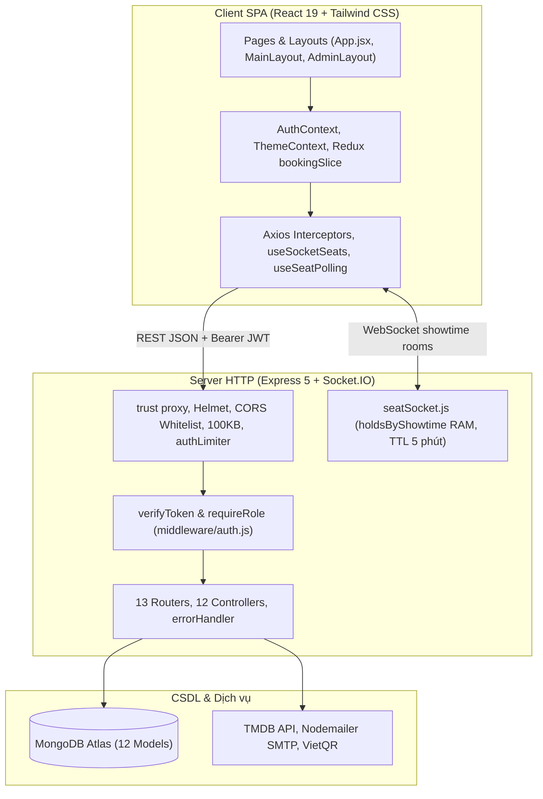
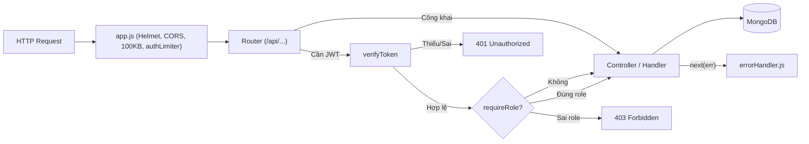
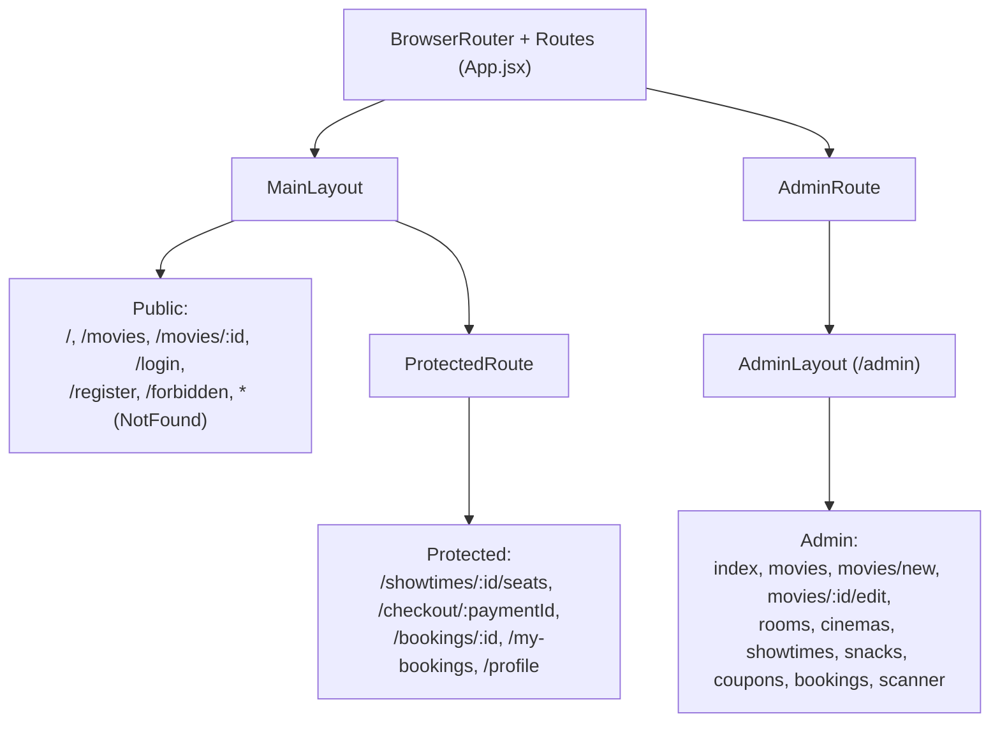
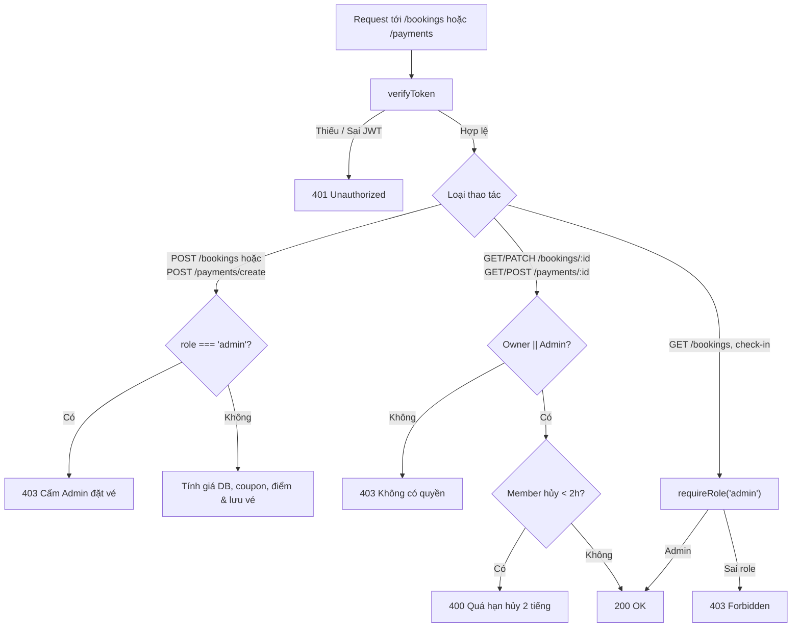
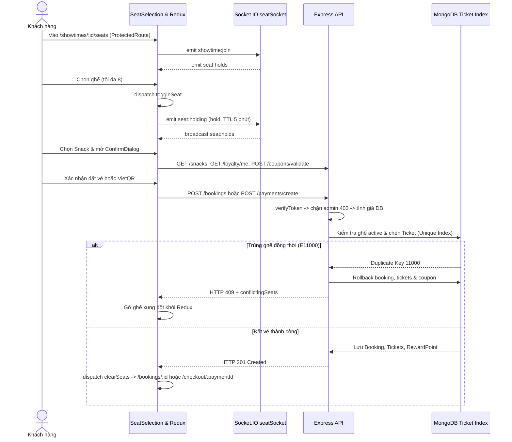

# Kiến trúc hệ thống và Phân quyền CineHub

> **Học phần:** Lập trình Web — Học viện Công nghệ Bưu chính Viễn thông (PTIT)  
> **Đề tài:** Hệ thống đặt vé xem phim trực tuyến CineHub (Nhóm 115)

---

## 1. Kiến trúc tổng thể hệ thống

CineHub áp dụng kiến trúc Client–Server tách biệt giữa giao diện Single Page Application (SPA) và API phía máy chủ trên nền MERN Stack. Việc tách tầng giúp trình duyệt phản hồi mượt khi lọc phim, xem lịch chiếu và chọn ghế, trong khi quy tắc xác thực, tính giá vé và chốt giao dịch tập trung ở Server để ngăn can thiệp dữ liệu.

Client dùng React `19.3.1` (`react-scripts` `5.0.1`), `react-router-dom` `6.30.6`, Tailwind CSS `3.4.19`, `axios` `1.21.1`, `socket.io-client` `4.8.4` và `qrcode.react` `4.2.0`; khi triển khai trên Vercel (`client/vercel.json`) hoặc Netlify (`client/netlify.toml`), mọi URL đều rewrite về `index.html`. Server dùng Express `5.3.0` và Mongoose `9.12.0` (`server/src/config/db.js`). Tại `server/src/server.js`, `app` được bọc trong `http.createServer(app)` để REST API và Socket.IO `4.8.4` (`server/src/socket/seatSocket.js`) dùng chung cổng `5000`, khớp cấu hình Render (`render.yaml`, `rootDir: server`, `healthCheckPath: /api/health`).

*Hình 1: Kiến trúc tổng thể hệ thống CineHub và luồng giao tiếp giữa các tầng.*

Trong `server/src/app.js`, request HTTP đi qua `app.set('trust proxy', 1)`, `helmet()`, `cors(corsOptions)` theo whitelist `CORS_ORIGINS`/`CLIENT_URL` (nguồn lạ trả `403`, request không có `origin` như Postman/curl vẫn hợp lệ), giới hạn body `100kb` (vượt ngưỡng trả `413`), và `authLimiter` (`server/src/middleware/rateLimit.js`: tối đa `10` lần sai trong `15 phút` trên `/api/auth`, `skipSuccessfulRequests: true`, vượt ngưỡng trả `429`). Cuối pipeline là `notFound` (`404`) và `errorHandler` (`server/src/middleware/errorHandler.js`) chuẩn hóa `CastError`, `11000`, `ValidationError`, `JsonWebTokenError` và `TokenExpiredError`.

| Thành phần | Thư viện / Công cụ | Phiên bản | Vai trò chính |
| --- | --- | --- | --- |
| Giao diện & Route | `react`, `react-dom`, `react-router-dom` | `^19.3.1`, `^6.30.6` | SPA, layout và route guard |
| Trạng thái Client | `@reduxjs/toolkit`, `react-redux` | `^2.15.0`, `^9.3.1` | Chọn tối đa 8 ghế và bắp nước |
| UI & Giao tiếp | `tailwindcss`, `qrcode.react`, `axios`, `socket.io-client` | `^3.4.19`, `^4.2.0`, `^1.21.1`, `^4.8.4` | Dark Mode, QR vé, Interceptor, WebSocket |
| Máy chủ & CSDL | `express`, `mongoose`, `socket.io` | `^5.3.0`, `^9.12.0`, `^4.8.4` | REST API, ODM MongoDB, giữ ghế real-time |
| Bảo mật & Email | `jsonwebtoken`, `bcryptjs`, `helmet`, `cors`, `express-rate-limit`, `express-validator`, `nodemailer` | `^9.0.3`, `^3.0.3`, `^8.3.0`, `^2.8.6`, `^8.7.5`, `^7.3.2`, `^10.6.1` | JWT, hash mật khẩu, HTTP headers, rate-limit, validate, SMTP |

*Bảng 1: Công nghệ và thư viện cốt lõi từ `client/package.json` và `server/package.json`.*

---

## 2. Cấu trúc thư mục thực tế của Client và Server

Mã nguồn tách thành `client/` và `server/`. Phía Client phân nhóm theo vai trò kỹ thuật và thư mục component theo miền; phía Server áp dụng mô hình MVC mở rộng gồm router, middleware, schema dữ liệu, controller, dịch vụ tích hợp và bộ kiểm thử.

| Thư mục (`client/`) | Tệp thực tế | Chức năng |
| --- | --- | --- |
| `client/` | `package.json`, `tailwind.config.js`, `vercel.json`, `netlify.toml` | Cấu hình phụ thuộc, Tailwind, SPA rewrite |
| `client/src/` | `index.js`, `App.jsx`, `index.css`, `setupTests.js` | Khởi tạo Store, Context, Routes |
| `api/`, `context/` | `axios.js`, `index.js`, `AuthContext.jsx`, `ThemeContext.jsx` | Axios Interceptor, Auth JWT, Theme |
| `hooks/` | `useLocalStorage.js`, `useSocketSeats.js`, `useSeatPolling.js`, `useCountdown.js`, `useDebounce.js`, `useFetch.js` | Lưu trình duyệt, WebSocket, polling 5s, đếm ngược, debounce |
| `layouts/`, `routes/` | `MainLayout.jsx`, `AdminLayout.jsx`, `ProtectedRoute.jsx`, `AdminRoute.jsx` | Bố cục chung và route guard |
| `store/`, `utils/` | `index.js`, `slices/bookingSlice.js`, `validators.js`, `youtube.js` | Redux Store, slice đặt vé, tiện ích |
| `pages/` | `Home`, `Movies`, `MovieDetail`, `SeatSelection`, `Checkout`, `BookingDetail`, `MyBookings`, `Profile`, `Login`, `Register`, `Forbidden`, `NotFound` (`.jsx`) | 12 trang trên `App.jsx` (`Seats.jsx`, `BookingSuccess.jsx` chưa gắn route) |
| `pages/admin/` | `Dashboard`, `Movies`, `MovieForm`, `Rooms`, `Cinemas`, `Showtimes`, `Snacks`, `Coupons`, `Bookings`, `TicketScanner` (`.jsx`) | 10 trang điều hành và soát vé QR |
| `components/` | `booking/*`, `seat/*`, `movie/*`, `showtime/*`, `cinema/*`, `home/*`, `ticket/*`, `admin/*`, `ui/*`, `CountdownTimer.jsx` | UI Kit và component theo nghiệp vụ |

*Bảng 2: Cấu trúc thư mục thực tế phía Client (`client/`).*

Tại `client/src/pages/`, `/showtimes/:id/seats` gắn `SeatSelection.jsx` (2 bước ghế–combo, Socket.IO, coupon, điểm thưởng), còn `Seats.jsx`, `BookingSuccess.jsx` và `components/seat/Seats.jsx` là thành phần độc lập phục vụ kiểm thử.

| Thư mục (`server/`) | Tệp thực tế | Chức năng |
| --- | --- | --- |
| `src/`, `config/` | `server.js`, `app.js`, `config/db.js` | HTTP + Socket.IO, Express, kết nối MongoDB |
| `src/middleware/` | `auth.js`, `errorHandler.js`, `rateLimit.js` | `verifyToken`, `requireRole`, `authLimiter`, `notFound`, `errorHandler` |
| `src/models/` | `User`, `Movie`, `Room`, `Cinema`, `Showtime`, `Booking`, `Ticket`, `Review`, `Coupon`, `Snack`, `Payment`, `RewardPoint` (`.js`) | 12 Schema, partial unique index, bcrypt |
| `src/routes/` | `admin`, `auth`, `booking`, `cinema`, `coupon`, `loyalty`, `movie`, `payment`, `room`, `showtime`, `snack`, `stats`, `user` (`.routes.js`) | 13 router gắn middleware |
| `src/controllers/` | `auth`, `booking`, `cinema`, `coupon`, `loyalty`, `movie`, `payment`, `review`, `room`, `showtime`, `snack`, `stats` (`.controller.js`) | 12 controller (`admin.routes.js`, `user.routes.js` xử lý trực tiếp) |
| `src/services/`, `src/socket/`, `src/templates/` | `email.service.js`, `tmdb.service.js`, `seatSocket.js`, `ticketEmail.html` | Email vé QR, TMDB, Socket.IO |
| `src/validators/`, `src/utils/`, `src/seed/` | `movie.validator.js`, `AppError.js`, `token.js`, `seed/index.js`, `seed/data/*` | Validator phim, JWT/lỗi, seed mẫu |
| `src/tests/`, `tests/` | 11 tệp (`src/tests/`), 7 tệp (`tests/`) | Kiểm thử tích hợp `node --test` |

*Bảng 3: Cấu trúc thư mục thực tế phía Server (`server/`).*

*Hình 2: Luồng xử lý yêu cầu qua Middleware, Router, Controller và Database phía Server.*

---

## 3. Sơ đồ Route React và phân biệt Layout / Route Guards

Tại `client/src/index.js`, `<Provider store={store}>` bọc `<App />`. Trong `client/src/App.jsx`, các lớp bọc lồng theo thứ tự `<ThemeProvider>` → `<AuthProvider>` → `<ToastProvider>` → `<BrowserRouter>` → `<Routes>`, chia ứng dụng thành tuyến công khai, tuyến yêu cầu đăng nhập và nhánh quản trị `/admin`.

*Hình 3: Sơ đồ phân cấp Route React trong `client/src/App.jsx`.*

| Đường dẫn | Component | Layout | Guard | Truy cập |
| --- | --- | --- | --- | --- |
| `/`, `/movies`, `/movies/:id` | `Home`, `Movies`, `MovieDetail` | `MainLayout` | Không | Công khai |
| `/login`, `/register`, `/forbidden`, `*` | `Login`, `Register`, `Forbidden`, `NotFound` | `MainLayout` | Không | Công khai (`403` / `404`) |
| `/showtimes/:id/seats` | `SeatSelection` | `MainLayout` | `ProtectedRoute` | Đã đăng nhập (`admin` bị API chặn `403`) |
| `/checkout/:paymentId`, `/bookings/:id` | `Checkout`, `BookingDetail` | `MainLayout` | `ProtectedRoute` | Đã đăng nhập (`Owner || Admin`) |
| `/my-bookings`, `/profile` | `MyBookings`, `Profile` | `MainLayout` | `ProtectedRoute` | Đã đăng nhập |
| `/admin` (`index`) | `Dashboard` | `AdminLayout` | `AdminRoute` | Chỉ `admin` |
| `/admin/movies`, `/admin/movies/new`, `/admin/movies/:id/edit` | `AdminMovies`, `MovieForm` | `AdminLayout` | `AdminRoute` | Chỉ `admin` |
| `/admin/rooms`, `/admin/cinemas`, `/admin/showtimes` | `RoomPage`, `Cinemas`, `ShowtimePage` | `AdminLayout` | `AdminRoute` | Chỉ `admin` |
| `/admin/snacks`, `/admin/coupons`, `/admin/bookings`, `/admin/scanner` | `AdminSnacks`, `AdminCoupons`, `AdminBookings`, `TicketScanner` | `AdminLayout` | `AdminRoute` | Chỉ `admin` |

*Bảng 4: Toàn bộ Route React, Layout và Guard trong `client/src/App.jsx`.*

### Phân biệt `MainLayout` và `AdminLayout`

- **`client/src/layouts/MainLayout.jsx`** bố cục dọc (`header` dính → `<main><Outlet /></main>` → `footer`). Header desktop chia 3 vùng: thương hiệu CineHub; nav trung tâm (`/`, `/movies`, `/my-bookings`, thêm `/profile` khi `isAuthenticated` và `/admin` khi `isAdmin`); cụm tiện ích gồm `CinemaSelector` (lưu `cinemaId` vào `localStorage` và phát `CustomEvent('cinema:change')`), nút theme và tài khoản. Trên di động (`< lg`), có thêm drawer menu và bottom bar với nút Trang chủ tròn ở giữa.
- **`client/src/layouts/AdminLayout.jsx`** bố cục hai cột cho khu vực điều hành. Sidebar trái (cố định trên desktop, drawer trên mobile) hiển thị 9 mục từ `ADMIN_LINKS` (`/admin`, `/admin/movies`, `/admin/rooms`, `/admin/cinemas`, `/admin/showtimes`, `/admin/snacks`, `/admin/coupons`, `/admin/bookings`, `/admin/scanner`) và nút `"Về trang khách"` về `/`. Header gồm nút theme, `{user?.fullName || 'Admin'}` và đăng xuất về `/login`.

### Phân biệt `ProtectedRoute` và `AdminRoute`

Cả `ProtectedRoute.jsx` và `AdminRoute.jsx` đều hỗ trợ `children || <Outlet />`, đọc `{ isAuthenticated, loading }` (riêng `AdminRoute` đọc thêm `isAdmin`) từ `useAuth()` và `useLocation()`. Khi `loading === true` (lúc F5 chờ `AuthContext` gọi `/auth/me`), cả hai hiển thị `<Spinner fullScreen />` để tránh redirect nhầm. `ProtectedRoute` chuyển hướng người chưa đăng nhập sang `<Navigate to="/login" state={{ from: location }} replace />` để `Login.jsx` quay lại đúng `pathname + search` sau đăng nhập; `AdminRoute` kiểm tra hai lớp: chưa đăng nhập đẩy về `/login`, còn `!isAdmin` chuyển sang `<Navigate to="/forbidden" replace />` (`Forbidden.jsx`). Các guard chỉ kiểm soát UI, còn quyền thực thi được khóa ở Backend.

---

## 4. Ma trận phân quyền đầy đủ (Frontend, Backend, Chặn Admin đặt vé và Ownership)

Phía máy chủ, `server/src/middleware/auth.js` cung cấp hai middleware chính: `verifyToken` lấy `Authorization: Bearer <token>`, xác minh JWT (`server/src/utils/token.js`, payload `{ id, role }`, mặc định `7d`), nạp lại `User.findById(decoded.id)` vào `req.user` (`401` nếu thiếu, hết hạn, sai chữ ký hoặc user không còn tồn tại); `requireRole(...roles)` đối chiếu `req.user.role` (`403` nếu không thuộc danh sách cho phép).

| Endpoint | Phương thức | Middleware | Guest | Member | Admin | Ràng buộc / Ownership |
| --- | --- | --- | --- | --- | --- | --- |
| `/api/health`, `/api/test-error` | `GET` | Không | Có | Có | Có | Health check và `errorHandler` |
| `/api/auth/register`, `/api/auth/login` | `POST` | `authLimiter` + validator | Có | Có | Có | Ép `role: 'member'`; tối đa 10 lần sai/15p (`429`) |
| `/api/auth/me` | `GET` | `verifyToken` | `401` | Có | Có | Trả user theo JWT (ẩn `passwordHash`) |
| `/api/users/me` | `GET`, `PUT` | `verifyToken` | `401` | Có | Có | Theo `req.user._id`; đổi pass cần `currentPassword` |
| `/api/loyalty/me` | `GET` | `verifyToken` | `401` | Có | Có | Trả điểm thưởng, hạng và lịch sử theo `req.user._id` |
| `/api/movies`, `/api/movies/genres`, `/api/movies/:id`, `/api/movies/:id/reviews` | `GET` | Không | Có | Có | Có | Xem phim và đánh giá |
| `/api/movies/:id/reviews` | `POST` | `verifyToken` | `401` | Có | Có | Unique `{ movieId, userId }` (`409`) |
| `/api/movies/tmdb/posters` | `GET` | `verifyToken`, `requireRole('admin')` | `401` | `403` | Có | Tra cứu poster phim từ TMDB |
| `/api/movies`, `/api/movies/:id` | `POST`, `PUT`, `DELETE` | `verifyToken`, `requireRole('admin')` | `401` | `403` | Có | Thêm, cập nhật và xóa phim |
| `/api/cinemas`, `/api/cinemas/:id`, `/api/showtimes`, `/api/showtimes/:id` | `GET` | Không | Có | Có | Có | Xem rạp, suất chiếu và `soldSeats` |
| `/api/cinemas*`, `/api/showtimes*` | `POST`, `PUT`, `DELETE` | `verifyToken`, `requireRole('admin')` | `401` | `403` | Có | Kiểm tra trùng lịch phòng |
| `/api/rooms`, `/api/rooms/:id` | `GET`, `POST`, `PUT`, `DELETE` | `router.use(verifyToken, requireRole('admin'))` | `401` | `403` | Có | Khách xem phòng qua suất chiếu/rạp |
| `/api/snacks`, `/api/snacks/:id` | `GET` | Không | Có | Có | Có | Lọc `isAvailable: true` (hoặc `?all=true`) |
| `/api/snacks`, `/api/snacks/:id` | `POST`, `PUT`, `DELETE` | `verifyToken`, `requireRole('admin')` | `401` | `403` | Có | Quản trị menu bắp nước |
| `/api/coupons`, `/api/coupons/:id` | `GET`, `POST`, `PUT`, `DELETE` | `verifyToken`, `requireRole('admin')` | `401` | `403` | Có | Danh sách và CRUD voucher |
| `/api/coupons/:id/toggle` | `PATCH` | `verifyToken`, `requireRole('admin')` | `401` | `403` | Có | Bật/tắt nhanh `isActive` của voucher |
| `/api/coupons/validate` | `POST` | Không | Có | Có | Có | Kiểm tra hạn, lượt dùng, đơn tối thiểu |
| `/api/bookings` | `POST` | `verifyToken` + check role | `401` | Có | `403` | **Cấm Admin đặt vé**; 1–8 ghế; tính giá Server |
| `/api/bookings/my`, `/api/bookings/my-bookings` | `GET` | `verifyToken` | `401` | Có | Có | Lọc `{ userId: req.user._id }` |
| `/api/bookings/:id` | `GET` | `verifyToken` + ownership | `401` | Chủ vé | Có | `booking.userId === req.user._id` hoặc `admin` (`403`) |
| `/api/bookings/:id/cancel` | `PATCH` | `verifyToken` + ownership | `401` | Chủ vé (`>=2h`) | Có | `Owner || Admin`; member `>= 2h`, admin mọi lúc |
| `/api/bookings` | `GET` | `verifyToken`, `requireRole('admin')` | `401` | `403` | Có | Danh sách toàn bộ đơn đặt vé (lọc, phân trang) |
| `/api/bookings/check-in`, `/api/bookings/:id/check-in` | `POST`, `PATCH` | `verifyToken`, `requireRole('admin')` | `401` | `403` | Có | Soát vé QR (`checked-in`, lưu `checkedInAt`) |
| `/api/payments/webhook` | `POST` | `x-webhook-secret` | Theo secret | Theo secret | Theo secret | Trước `verifyToken`; sai secret trả `401` |
| `/api/payments/create` | `POST` | `verifyToken` + check role | `401` | Có | `403` | **Cấm Admin đặt vé**; giữ chỗ VietQR 10p |
| `/api/payments/:id`, `/api/payments/:id/cancel` | `GET`, `POST` | `verifyToken` + ownership | `401` | Chủ đơn | Có | `payment.userId === req.user._id` hoặc `admin` (`403`) |
| `/api/admin/ping`, `/api/stats/*` | `GET` | `router.use(verifyToken, requireRole('admin'))` | `401` | `403` | Có | Ping admin và thống kê doanh thu/lấp đầy |

*Bảng 5: Ma trận phân quyền đầy đủ trên toàn bộ API Backend của CineHub.*

Ba cơ chế phân quyền trọng yếu gồm:
1. **Cấm Admin đặt vé:** `createBooking` (`booking.controller.js`) và `createPaymentSession` (`payment.controller.js`) chặn `req.user.role === 'admin'` với mã `403` để tách biệt điều hành và khách hàng. Ở Client, `SeatSelection.jsx` nhận `403` từ Server trong `ConfirmDialog`, còn `Seats.jsx` khóa bấm ghế và hiện `admin-booking-warning`.
2. **Kiểm tra sở hữu (`Ownership`):** Để chống IDOR, `getBookingById`, `cancelBooking`, `getPaymentStatus` và `cancelPayment` bắt buộc `resource.userId.toString() === req.user._id.toString() || req.user.role === 'admin'` (`403`). Khi hủy đơn, `member` chỉ hủy được trước giờ chiếu `>= 2 giờ` (`< 2h` → `400`), còn `admin` được miễn. Các endpoint `/users/me`, `/loyalty/me`, `/bookings/my` đọc trực tiếp `req.user._id`.
3. **Webhook & chống leo thang quyền:** `POST /api/payments/webhook` đặt trước `router.use(verifyToken)` trong `payment.routes.js` và đối chiếu `x-webhook-secret` với `PAYMENT_WEBHOOK_SECRET`. Ngoài ra, `register` ép `role: 'member'`, còn `PUT /api/users/me` bỏ qua `role`/`email`.

*Hình 4: Luồng xác thực, chặn Admin đặt vé và kiểm tra quyền sở hữu tài nguyên.*

---

## 5. Quản lý trạng thái với Context API và Redux Toolkit

CineHub dùng **React Context API** (qua `useLocalStorage`) cho dữ liệu toàn cục ít thay đổi và **Redux Toolkit** cho giỏ chọn ghế/bắp nước thay đổi liên tục nhằm tránh re-render toàn cây component.

### 5.1. `useLocalStorage`, `AuthContext` và `ThemeContext`

- **`useLocalStorage.js`:** Đồng bộ state với `localStorage` qua `JSON.parse` (fallback chuỗi thô), tự `removeItem` khi giá trị là `null`/`undefined` (có `removeValue`), và nghe `'storage'` để đồng bộ đa tab.
- **`AuthContext.jsx` & `axios.js`:** Lưu `token` (`TOKEN_STORAGE_KEY = 'cinema_token'`) và `user` (`USER_STORAGE_KEY = 'cinema_user'`) qua `useLocalStorage`, cung cấp `{ user, token, loading, isAuthenticated, isAdmin, login, logout, updateUser }` qua `useAuth()`. Khi F5, `AuthProvider` gọi `GET ${API_BASE_URL}/auth/me` với `AbortController` (`401` → `logout()`, `200` → cập nhật `user`). Trong `axios.js`, Request Interceptor gắn `Authorization: Bearer <token>`; Response Interceptor khi nhận `401` (trừ `/auth/login`, `/auth/register`) xóa storage và phát `AUTH_UNAUTHORIZED_EVENT = 'auth:unauthorized'` để `AuthProvider` đăng xuất đồng bộ.
- **`ThemeContext.jsx`:** Lưu `cinema_theme` (mặc định `prefers-color-scheme: dark`), cập nhật class `'dark'` và `data-theme` trên `document.documentElement`, cung cấp `{ theme, isDark, toggleTheme, setTheme }` qua `useTheme()`.

### 5.2. Redux Toolkit (`client/src/store/index.js` và `bookingSlice.js`)

`store` đăng ký `booking: bookingReducer` với state `{ showtimeId: null, selectedSeats: [], selectedSnacks: [], error: null }`:
- **`setShowtimeId` (`setBookingShowtime`):** Reset `selectedSeats`, `selectedSnacks`, `error` khi đổi suất.
- **`toggleSeat`:** Bật/tắt ghế `{ row, number }`; khi `selectedSeats.length >= 8`, chặn ghế thứ 9 và gán `state.error = 'Bạn chỉ có thể chọn tối đa 8 ghế!'`. `SeatSelection.jsx` không gửi `emitSeatHold` cho ghế thứ 9, `BookingSummary.jsx` hiện `({sortedSeats.length}/8)`, Server kiểm tra lại `seats.length` trong `1..8`.
- **`setSelectedSnacks`, `updateSnackQuantity`, `clearSnacks`:** Chuẩn hóa combo, giới hạn `1..20`/món (`0` sẽ xóa).
- **`clearSeats`, `clearBookingError` (`clearError`):** Xóa ghế, combo và lỗi.
- **Selectors:** `selectBookingState` (`selectBooking`), `selectShowtimeId`, `selectSelectedSeats`, `selectSelectedSnacks`, `selectSnackTotal`, `selectSelectedSeatCount` (`selectSelectedSeatsCount`), `selectBookingError`, `selectTotalPrice` (ghế + `selectSnackTotal`), `selectIsSeatSelected(row, number)`.

| Tiêu chí | Context API (`AuthContext`, `ThemeContext`) | Redux Toolkit (`bookingSlice`) |
| --- | --- | --- |
| Tần suất | Thấp (đăng nhập, F5, đăng xuất, theme) | Cao (chọn/bỏ ghế, tăng/giảm combo) |
| Lưu trữ | Đồng bộ `localStorage` qua `useLocalStorage` | Bộ nhớ phiên theo suất chiếu |
| Dữ liệu | `user`, `token`, `loading`, `isAuthenticated`, `isAdmin`, `theme`, `isDark` | `showtimeId`, `selectedSeats` (<= 8), `selectedSnacks` (1–20), `error` |
| Tích hợp | Layouts, Guards, `axios.js` | `SeatSelection`, `SnackSelector`, `BookingSummary`, `ConfirmDialog`, `CountdownTimer` |

*Bảng 6: Phân công trách nhiệm giữa Context API và Redux Toolkit trong CineHub.*

### 5.3. Tích hợp Chọn ghế – Combo – Coupon/Loyalty – Socket.IO

Tại `SeatSelection.jsx` (`step = 'seats' | 'snacks'`), `useSocketSeats(id)` vào phòng `showtime:${showtimeId}` (`showtime:join`), phát `seat:holding` (`hold`/`release`) và nhận `seat:holds` để lọc `heldByOthers`. Ở Server, `seatSocket.js` giữ trạng thái trong `holdsByShowtime` (`HOLD_TTL_MS = 5 * 60 * 1000`, khớp `CountdownTimer.jsx`), phát `seat:hold-rejected` nếu socket khác đang giữ và tự nhả ghế khi hết TTL, `showtime:leave` hoặc `disconnect`. Song song đó, `useSeatPolling(id, 5000)` gọi `GET /api/showtimes/:id` mỗi 5 giây để đồng bộ `soldSeats` và tự gỡ khỏi Redux các ghế đã bị giữ hoặc bán.

Ở bước 2, `SnackSelector` tải menu từ `GET /api/snacks`; `SeatSelection` tính sẵn `{ regularCount, vipCount, totalAmount }` qua `useMemo` rồi truyền xuống `BookingSummary` để hiển thị (trong khi `BookingSummary` dùng `useMemo` cho `sortedSeats` và `formattedDateTime`). Trong `ConfirmDialog.jsx`, `CouponInput` gọi `POST /api/coupons/validate` và nạp điểm từ `GET /api/loyalty/me`. Khách có thể xác nhận ngay (`POST /api/bookings` gửi `couponCode`, `pointsToUse`, `snacks` để trừ/tích `5%` điểm `RewardPoint` và gửi email vé QR) hoặc dùng VietQR (`POST /api/payments/create` gửi `couponCode`, `snacks` giữ chỗ 10 phút tại `/checkout/:paymentId` polling `GET /api/payments/:id` mỗi 3 giây). Cả hai API đều tính lại giá từ DB, kiểm tra trùng ghế 2 tầng (pre-check + partial unique index `E11000` trên `Ticket` kèm rollback) và trả `409` với `conflictingSeats`.

*Hình 5: Sơ đồ tuần tự luồng đặt vé thời gian thực kết hợp Redux Toolkit, Socket.IO và MongoDB.*
